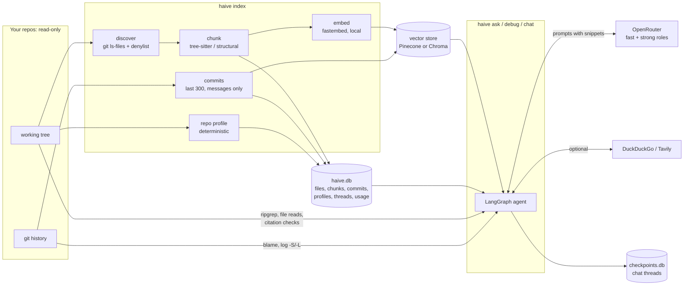
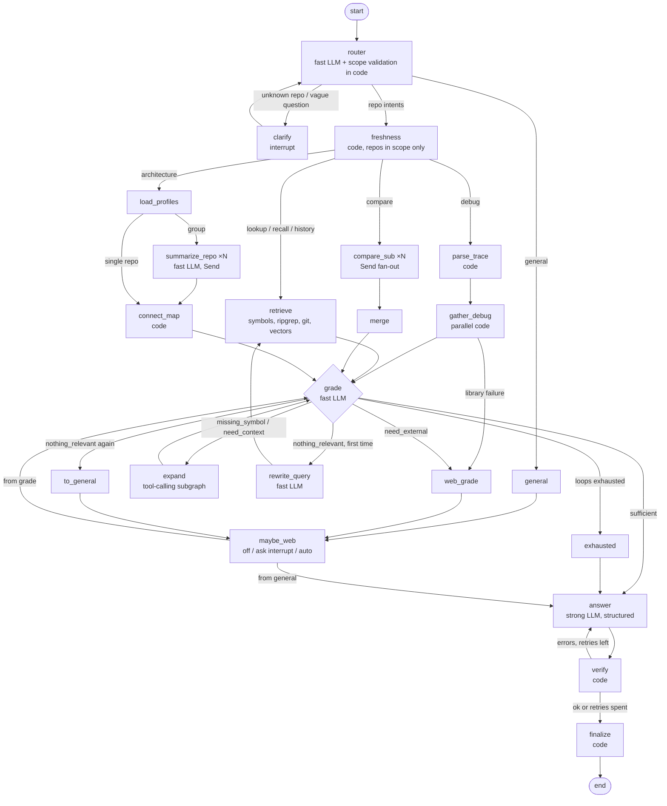

# Architecture

## Data flow

**The working tree is the source of truth.** File reads, ripgrep, git, and citation checks always run
against the live repo; SQLite and the vector store are indexes of it. Evidence from vector hits is
re-read from the live file before it reaches a prompt.

## The graph

- **Budget guard**: every LLM-calling node gets a meter capped at the calls left for the question.
  Grade, rewrite, and summaries hold one call back for the answer; with no calls left, `answer` builds an
  evidence-only answer in code.
- **Interrupts** (clarify, web approval) need a checkpointer. `ask`/`debug` use a throwaway thread in the
  same SQLite saver and delete it afterwards. Without a terminal, interrupts resolve to defaults
  (scope = all, web declined) and a notice says so.
- **Chat** reuses the thread's `messages`, so the router sees recent turns and follow-ups like "and in
  the other repo?" resolve. Per-turn accumulators (evidence, notices, call counts) reset on each turn via
  reducers that treat `None` as "reset".
- **Expand** is a nested LangGraph: `plan` (the fast model with five `@tool`s bound: `find_definition`,
  `find_usages`, `read_file`, `search_code`, `recent_commits`) → `tools_condition` → prebuilt `ToolNode`,
  which runs the chosen calls in parallel. Each tool returns `(content, artifact)`; the artifacts are
  evidence dicts. When the model can't call tools, fails, or the budget can't cover a planning call,
  deterministic heuristics produce the plan and the same `ToolNode` runs it.
- **Verification** (`graph/verify.py`) is pure code: a repo claim's file must exist in the live tree, the
  lines must be in range, the symbol must appear within ±3 lines, and the path must be among this run's
  evidence; a commit ref's sha must match a commit in this run's evidence; web URLs must be among this
  run's results; model claims carry no refs. Debug diffs are checked line by line against the cited
  file. A failed answer is retried with the errors, but a retry that fixes less than half of them ends
  the loop.

## Where LangChain and LangGraph are used

| Concern | Library piece | Where |
|---|---|---|
| Orchestration | `StateGraph`, conditional edges, reducers, `add_messages` | `graph/build.py`, `graph/state.py` |
| Parallel fan-out | `Send` | `graph/fanout.py` (compare targets, per-repo summaries) |
| Human in the loop | `interrupt` / `Command(resume=…)` | `graph/router.py` (clarify), `graph/web_node.py` (web approval) |
| Persistence | `SqliteSaver` (chat), `InMemorySaver` (tests) | `runtime.py`, `graph/build.py` |
| Tool use | `@tool(response_format="content_and_artifact")`, `ToolNode`, `tools_condition`, `bind_tools` | `graph/agent_tools.py`, `graph/expand.py` |
| Models | `init_chat_model`, `InMemoryRateLimiter`, `.with_fallbacks()` | `llm/models.py` |
| Structured output | `with_structured_output(method="function_calling")`, `PydanticOutputParser`, LCEL, `with_fallbacks(exception_key=…)` | `llm/structured.py` |
| Prompts | `ChatPromptTemplate`, `MessagesPlaceholder` | `prompts/__init__.py` |
| Observability / budgets | `BaseCallbackHandler` (`on_chat_model_start`, `on_llm_end`, `on_tool_*`) | `llm/budget.py` |
| Retrieval | `Embeddings`, `Document`, `InMemoryVectorStore`, `PineconeVectorStore`, `Chroma` | `index/embed.py`, `store/` |

Deliberately hand-written: chunking (tree-sitter), discovery and the secrets denylist, git/ripgrep
tools, trace parsing and path mapping, the repo profile and connection map, and claim verification.
These are domain logic with no LangChain equivalent.

## Modules

| Path | Role |
|---|---|
| `types.py` | Shared contracts: Chunk, Hit, Evidence, WebResult, Frame/ParsedTrace, Answer/Claim/refs, RepoProfile, protocols |
| `config.py`, `paths.py`, `db.py` | TOML config and scope resolution, platform paths, SQLite schema + migrations |
| `index/` | discover, chunk_code (tree-sitter), chunk_text, commits, profile, embed, pipeline, freshness |
| `store/` | thin adapter over LangChain vector stores (`InMemoryVectorStore`, `PineconeVectorStore`, `Chroma`) |
| `tools/` | read-only git, ripgrep (+ fallback), file windows, trace parsers, path mapping, web search |
| `llm/` | `init_chat_model` + `InMemoryRateLimiter`, `.with_fallbacks()` chains, LCEL structured output, the metering callback |
| `prompts/` | versioned `*.md` files loaded as `ChatPromptTemplate`s (system / history / human sections) |
| `graph/` | state, router, retrieve, debug, fanout, grade, expand (+ `agent_tools`), web_node, answer, verify, finalize, build |
| `render.py`, `threads.py`, `runtime.py`, `cli.py` | output, chat thread metadata, wiring, commands |
| `eval/` | suite runner, metrics, bug injection, sample setup |
